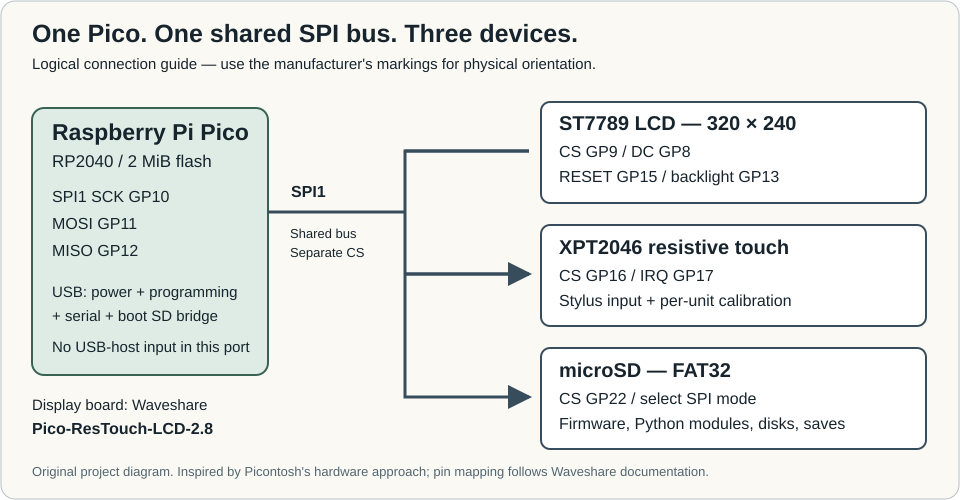

# Hardware

[Project overview](../README.md) · [Documentation](wiki/Home.md) · [Build guide](BUILD.md)

For the numbered assembly and installation procedure, use [QUICKSTART.md](QUICKSTART.md).

Hardware inspiration: [Simon Boak's Picontosh article and original photographs](https://unimplementedtrap.com/picontosh-exploring-classic-macintosh-icon-format/). We follow the Pico + Waveshare + SD approach; the diagram above is a new logical illustration. It is not a physical mounting-orientation drawing or a copied blog photograph.

Validated prototype: RP2040 Raspberry Pi Pico, 2 MiB flash, Waveshare **Pico-ResTouch-LCD-2.8** (ST7789 + XPT2046), FAT32 microSD. A 16 GB card was used. Pico 2 and other panel variants have not been validated by this port.

| Signal | Pico GPIO |
|---|---|
| SPI1 SCK / MOSI / MISO | GP10 / GP11 / GP12 |
| LCD CS / DC | GP9 / GP8 |
| LCD RESET / backlight | GP15 / GP13 |
| Touch CS / IRQ | GP16 / GP17 |
| SD CS | GP22 |

LCD, touch and SD share SPI1 and have separate chip selects. The drivers restore clock/mode for each operation; do not mix concurrent host SD writes with the running guest. If the board has an SPI/SDIO selector, this implementation requires SPI.

| Flash offset | Reserved | Purpose |
|---|---|---|
| `0x000000` | 512 KiB | PicoBoot menu |
| `0x080000` | 1 MiB | Selected native or MicroPython application |
| `0x180000` | 512 KiB | MicroPython LittleFS |

The linkers and boot writer enforce application bounds. Normal SD firmware selection does not rewrite the menu or LittleFS. A stock full-device UF2 can replace this layout; keep your own recovery backup before installing.

`config/touch_cal.example.json` contains coefficients measured on one prototype screen, not universal factory calibration. Run the touch desk's calibration on your own unit, then use its six-value `touch_cal.json` when building the native port. Boot-menu calibration is in the board preset patch and may need updating independently.

No USB-host circuit or keyboard/mouse hub support is supplied. USB is used for power, serial debugging, MicroPython access and PicoBoot's SD bridge.

## Manufacturer references

[Waveshare board wiki](https://www.waveshare.com/wiki/Pico-ResTouch-LCD-2.8) — pin mapping, ST7789/XPT2046 controller references and example code. [Product specifications](https://www.waveshare.com/product/pico-restouch-lcd-2.8.htm). This port uses SPI for the SD slot; do not substitute the SDIO pins for the SPI configuration above.
