# Real-device screenshots

[Project overview](../README.md) · [Documentation](wiki/Home.md) · [Verification](VERIFICATION.md)

**28 original-size 320×240 PNGs**, captured from a physical RP2040 Pico with the Waveshare Pico-ResTouch-LCD-2.8. These are real display images from scripted interactions and sample data, with no generated scenes, case mockups, screen borders or rescaling.

## Capture scope

- **One boot-menu scene:** the device's LVGL display tiles were written to BMP, read back from SD and converted losslessly to PNG. Decoded RGB pixels match the source BMP.
- **15 MacTouch scenes:** device-written framebuffer images were checked against the device's framebuffer CRC after SD readback.
- **12 native scenes:** all 240 row checks were verified for each capture, including the filtered grayscale Fit view.
- Every exported PNG was visually reviewed. [Machine-readable provenance and SHA-256 hashes](screenshots/captures.json).

**Versions:** MacTouch Classic 0.3.0 and native emulator 0.3.2, plus the installed prototype boot menu. The public-source variant replaces the prototype's font and smile/welcome artwork. These images document the prototype, not physical validation of the replacement public visuals.

System/Finder and classic games shown below were separately supplied for the private working disk and are not bundled with this repository. Third-party interface, font, trademark and game artwork remains with its respective owners; source licenses do not relicense those pixels.

The original working disk was backed up and restored with SHA-256 verification after the application demos. MacTouch sample drawings and notes used an isolated demo namespace. The added boot-menu capture did not replace the firmware or guest disk; the device returned to Finder afterwards.

## Startup: choose an environment


The installed prototype presents Macintosh / System 3.2 and MacTouch Classic. The public source uses original terminal artwork instead of this historical-style welcome screen.

## MacTouch: desktop, creativity and touch games

| Scene | Scene |
|---|---|
| **Boot and SD ready**<br>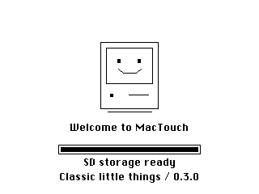 | **Touch desktop**<br>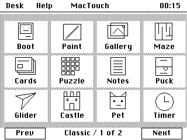 |
| **Second desktop page**<br>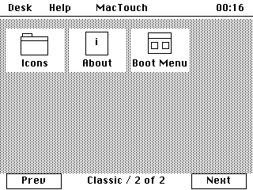 | **Drawing and patterned fill**<br>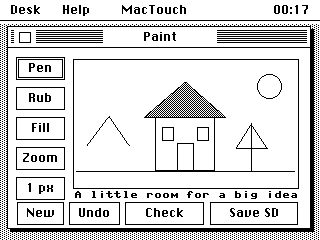 |
| **Zoom and navigator**<br>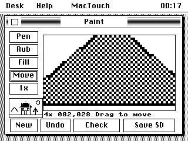 | **Saved drawing in SD gallery**<br>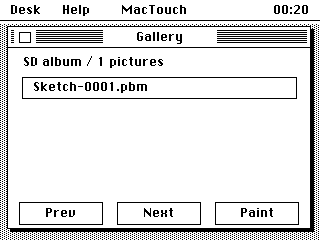 |
| **Reloaded drawing**<br>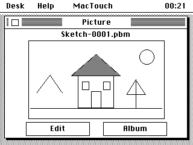 | **Maze and hint**<br>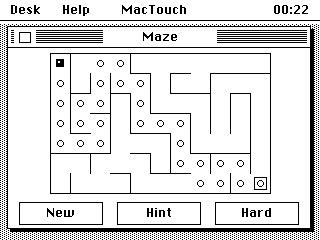 |
| **Sliding puzzle**<br>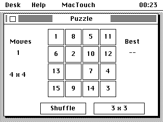 | **Original card story**<br>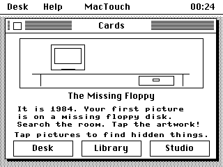 |
| **Notes and on-screen keyboard**<br>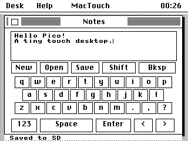 | **Air hockey paddle movement**<br>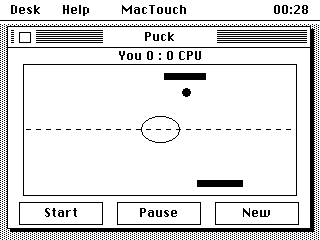 |
| **Rally, later frame**<br>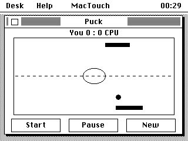 | **Paper glider in flight**<br>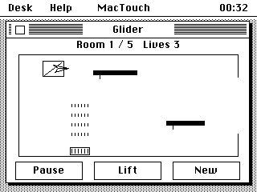 |
| **Castle jump**<br>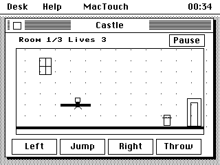 |  |

## Native emulator: applications and games

| Scene | Scene |
|---|---|
| **Finder at crisp 1x**<br> | **Blackjack: bet selection**<br>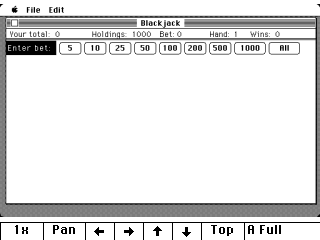 |
| **Blackjack: full hand in Fit**<br>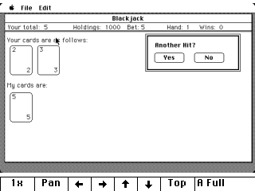 | **Blackjack: decision dialog at 1x**<br>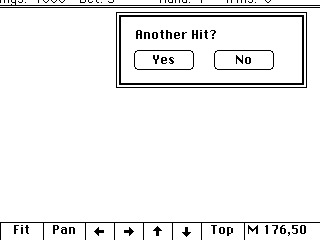 |
| **Blackjack: end-of-hand result**<br>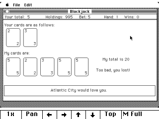 | **Brickles: ready to begin**<br>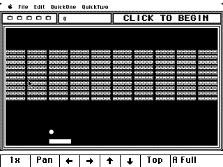 |
| **Brickles: ball, bricks and paddle**<br>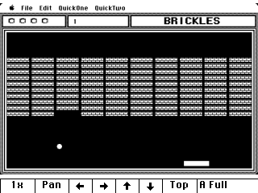 | **Missile Command: explosions after firing**<br>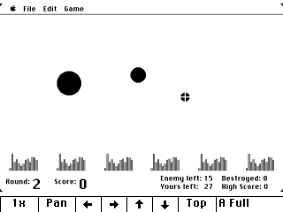 |
| **Calculator: 128 + 64 = 192**<br>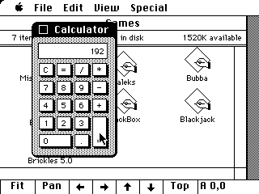 | **Daleks: field and direction controls**<br>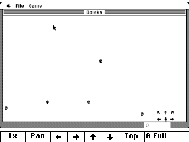 |
| **BlackBox: logic board**<br>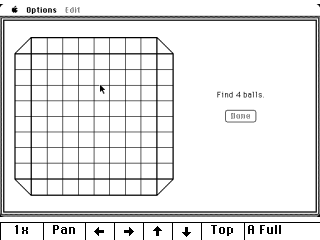 | **Back to Finder after the demo**<br>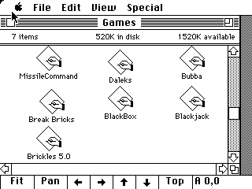 |

## Capture your own native scene

```sh
python scripts/capture_screen.py --port COM4 --output build/captures/lcd.png
```

Run this from the repository root, replacing `COM4` with your device port. The utility targets the native environment; boot-menu and MicroPython captures use different paths. See the [build guide](BUILD.md) for dependencies. Review any new image before sharing it.
