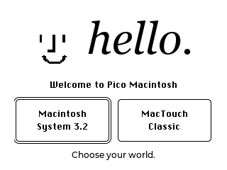

# Documentation

[Project overview](../../README.md) · [Gallery](../SCREENSHOTS.md)

Welcome to **Pico RetroTouch**: a MicroPython touch desktop and an early Macintosh emulator sharing one RP2040 Pico, SPI touchscreen and SD card.

*Prototype capture. The public source uses replacement welcome artwork and a replacement font; see [verification](../VERIFICATION.md).*

## Choose your path

| Goal | Guide |
|---|---|
| Use a prepared device | [User guide](User-guide.md) — environment selection, touch gestures, apps and viewport controls |
| Assemble and install | [Hardware](../HARDWARE.md), then [Build from source](../BUILD.md) |
| Follow every installation stage | [Assembly and first boot](../QUICKSTART.md) |
| Understand SD files and add software | [Software and storage](Software-and-storage.md) — archives, guest disks and backups |
| Identify external software sources | [Software provenance and excluded files](../SOFTWARE-SOURCES.md) |
| Learn with an AI coding assistant | [Suggested development loop](../AI-WORKFLOW.md) |
| Understand the planned parts kit | [Kit details](../KIT.md) · [Tindie listing draft](../TINDIE-LISTING.md) |
| Extend the project | [Architecture](Architecture.md) — firmware boundaries, source map and useful checks |
| Understand its foundations | [Origins and credits](Origins-and-credits.md), [notices](../../THIRD_PARTY_NOTICES.md) and [licenses](../../LICENSE.md) |
| Review evidence or prepare a fork | [Verification](../VERIFICATION.md), [screenshots](../SCREENSHOTS.md) and [publishing](../PUBLISHING.md) |

## Read these first

- The two environments are separate programs. MacTouch is a new miniature desktop; the native environment emulates a computer and runs separately supplied guest software.
- The emulator has **192 KiB RAM**, not a full Macintosh Plus memory configuration.
- A `.sit` file is an archive, not a directly runnable SD application. There is no universal on-device archive importer.
- This repository supplies source and documentation, not ROMs, operating systems, game collections or ready-to-flash native firmware.

These pages live inside the repository. They can be browsed on GitHub or read offline without enabling a separate GitHub Wiki.
